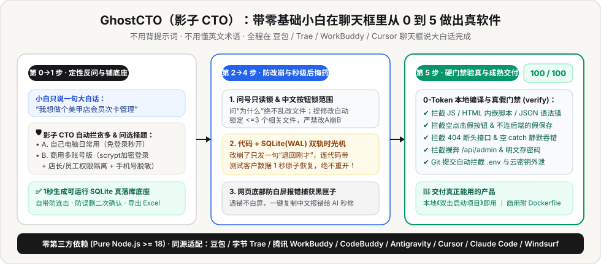

<div align="center">


# GhostCTO (影子 CTO)

### **A 100% free, zero-dependency engineering guardrail for building ANY software from `0` to `5` — websites, multi-module AI SaaS platforms, interactive tools, WeChat mini-programs, and open-source developer tools (including GhostCTO itself at `100/100`).**

[-059669?style=flat-square)](#)
[-059669?style=flat-square)](#)
[-7C3AED?style=flat-square)](#)
[](#)
[-18181B?style=flat-square)](./LICENSE)

[**简体中文文档**](./README.md) ｜ [**Step-by-Step Chat Guide (全链路手册)**](./小白与AI对话全链路通关手册.md) ｜ [**Install Guide**](./INSTALL.md) ｜ [**Security Policy**](./SECURITY.md)

</div>

<p align="center">
  
</p>

---

## What GhostCTO Guarantees (Verified by 17 Automated & Self-Dogfooding Test Suites)

1. **Zero Category Lock-In (`website`, `saas_platform`, `interactive_tool`, `business_app`, `miniprogram`, `dev_tool`)**:
   - Generates a 5-stage `v0.1 → v1.0` product roadmap (`.vibe/roadmap.json`) and optional full-stack SQLite starting layouts (Website Hero/Showcase, Multi-Module SaaS Sidebar Workbench, or Native WeChat Mini-Program + Web) while letting AI build bespoke pages, multi-table schemas, and external API pipelines across Next.js, React, Vue, FastAPI, or Node.
2. **Compiler / Linker / SQL Gate + IDE `Stop` Hook (`kernel/code-verifier.mjs`, `.vibe/ghost-hook-check.mjs`)**:
   - Deterministically blocks JS/HTML/JSON syntax errors, uninstalled npm packages, broken local imports, missing named ESM exports, SQL column mismatches, 404 dead APIs, empty click handlers, fake client-only save toasts, silent `catch {}`, and unprotected `/api/admin` routes at **0 LLM tokens**.
3. **Lossless SQLite Auto-Migration & Atomic Code+DB Time Machine**:
   - `autoMigrateSqliteSchema` automatically adds new columns via `ALTER TABLE ADD COLUMN` without losing existing user rows; `save` and `rewind` snapshot and restore Git + SQLite (`.sqlite` + `-wal`) atomically.
4. **100% Dogfooded on Itself (`tests/self-dogfood.test.mjs`)**:
   - GhostCTO governs its own repository: every source file is strictly `< 500` lines, `npm run self:verify` exits `0`, and `npm run self:audit` scores **`100 / 100`** (`P0: 0, P1: 0, P2: 0`).

## Quick Start

```bash
git clone https://github.com/liyunhu1992-ux/ghost-cto.git
cd ghost-cto
npm run self:verify && npm run self:audit         # Verify GhostCTO dogfooding itself (100/100)
npm test                                          # Run all 17 unit, adversarial & dogfood test suites
node bin/ghost-cto.mjs create "my-product"        # Create a clean guarded workspace on Desktop
node bin/ghost-cto.mjs init /path/to/your-project # Install into any existing repository
```

## License

[MIT](./LICENSE) — 100% free and open-source.
