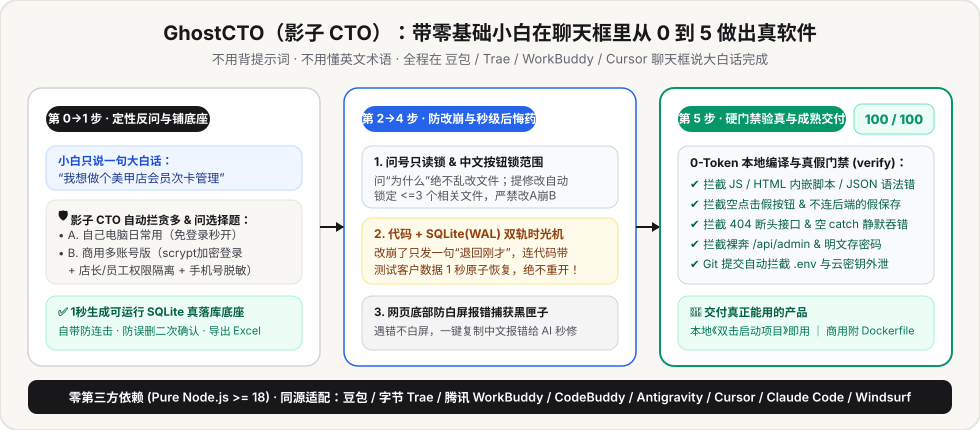
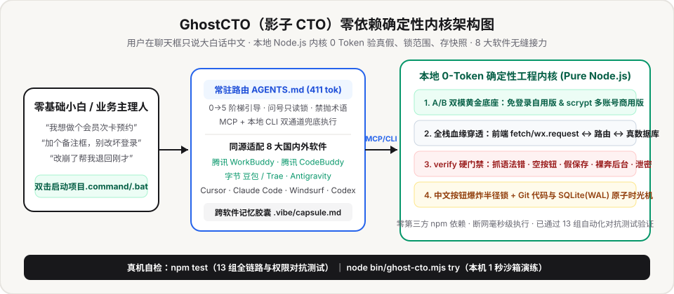

<div align="center">


# GhostCTO（影子 CTO）

### **让完全不懂代码的零基础小白，在 AI 聊天框里只说大白话，从 `0` 到 `5` 做出真正能用的成熟软件。**

**零第三方依赖（Pure Node.js >= 18）· 一次接入字节 Trae / 豆包、腾讯 WorkBuddy / CodeBuddy、Antigravity、Cursor、Claude Code、Windsurf：**  
**自动拦贪多画饼、替你拍板技术栈、把专业开发团队才懂的细节（真 SQLite 落库、加密登录、员工分权、防连击、防误删、导出 Excel）一次配齐，并用本地 0-Token 门禁死死拦住假按钮与改崩事故。**

[-059669?style=flat-square)](#)
[-2563EB?style=flat-square)](#)
[-7C3AED?style=flat-square)](#)
[](#)
[-18181B?style=flat-square)](./LICENSE)

[**📖 零基础小白与 AI 对话全链路通关手册**](./小白与AI对话全链路通关手册.md) ｜ [**安装与配置指南**](./INSTALL.md) ｜ [**英文弹窗急救词典**](./docs/POPUP_DICTIONARY.md) ｜ [**English README**](./README.en.md) ｜ [**安全说明**](./SECURITY.md)

</div>

<p align="center">
  
</p>

> [!TIP]
> **不需要背任何提示词，也不需要看任何复杂的“驾驶舱”后台！**  
> 下载解压后双击 **`1-双击新建我的空白项目`**，用你的 AI 编程软件打开桌面上自动建好的干净文件夹，直接在聊天框说一句最普通的话（比如：“我想做个美甲会员预约”），AI 就会按 `0 → 5` 的正规工程节奏一步步带你做出来。  
> 👉 先看 3 分钟实操对话演示：[**《零基础小白与 AI 对话全链路通关手册》**](./小白与AI对话全链路通关手册.md)

---

## 💡 为什么要做这个开源项目？（直击小白 Vibe Coding 最痛的翻车现场）

市面上大多数 AI 编程插件是给程序员写的（满屏 Git 分支、AST 术语、单元测试命令）。而一个完全不懂代码的新手想用 AI 做出能真正干活的产品时，几乎都会栽在下面这 **6 个真实大坑**里：

| 小白自己摸索必踩的坑 | 没有保护时 AI 的常见表现 | **GhostCTO（影子 CTO）在聊天框里的硬核矫正** |
| :--- | :--- | :--- |
| **1. 说不清要什么 / 一口气贪多**<br>脑子里只有零碎念头，或者一上来就要做 20 个大模块 | AI 照单全收，一口气生成 20 个点不动的假菜单和样板房空壳 | **第 0 步定性反问与急刹车**：贪多超过 3 个模块强制劝阻收敛；主动问清 **A. 自己电脑免登录用** 还是 **B. 多账号商用版** |
| **2. 想不到专业开发团队的细节**<br>只知道说“做个增删改查”，上线才发现没权限、误删没确认、导不出表格 | 你不提 AI 就不写：密码明文裸存、点一下删除直接清空、连点两下存两条重复数据 | **第 1 步自动配齐专业底座**：内置防连击锁、防误删二次确认、在线编辑、UTF-8 BOM 零乱码导出 Excel；选 **B 版**直接配好 **`scrypt` 加盐密码加密 + 店长/员工分权 + 手机号脱敏 (`138****8801`) + 操作留痕日志 + `Dockerfile`** |
| **3. 表面提示“保存成功”，刷新全丢**<br>按钮能点也弹绿框了，结果第二天打开数据全没了 | AI 最喜欢写内存假数组或只弹前端提示不调后端接口糊弄交差 | **`ghost-cto verify` 0-Token 硬门禁**：本地词法与全栈血缘追踪，抓到空点击假按钮、不连后端的假保存、内存假落库或空 `catch {}`，直接拦截不准 AI 交差 |
| **4. 随口问一句“为什么”，代码被改废**<br>只是想问问原因，AI 咔咔把七八个正常文件改崩了 | 分不清“咨询问题”与“动手改代码”，每次乱动一堆无关文件 | **问号只读锁 + 中文按钮名爆炸半径锁**：带问号咨询强制 `0 修改`；动手前自动按中文按钮词锁定 `<=3` 个文件上限 |
| **5. 越改越乱，崩溃删文件夹重来**<br>改一个颜色把登录搞挂了，连改三次绝望重开“最终版v4” | 越修越错进入死循环，甚至把测试攒的客户数据也搞丢了 | **防弃坑后悔药（代码 + SQLite 双轨时光机）**：聊天框发一句“改崩了退回刚才”，1 秒把 Git 代码和 SQLite（含 `-wal`）一起字节级还原 |
| **6. 重启电脑打不开 / 密钥误传泄密**<br>隔天打开报端口占用 `EADDRINUSE`，或者把 `.env` 密钥传上网被盗刷 | 让你自己去黑框敲 `lsof`、`kill -9`；对明文密钥毫无拦截 | 自动生成自愈式 **《双击启动项目》**（自动清卡死端口并打开浏览器）+ **`.git/hooks/pre-commit` 本地防泄密急刹车** |

---

## 🚀 30 秒极速开局（已通过真机全链路验证）

> **环境要求**：电脑装有基础 **`Node.js >= 18`** 即可（0 第三方依赖，断网也能运行）。

### 方式一：纯小白双击向导（一行命令都不用敲）
1. 点击本页面右上角绿色 **`Code` -> `Download ZIP`** 下载并解压；
2. 根据你的需求双击对应文件：
   - 🌱 **我要从 0 做个新产品**：双击 **`1-双击新建我的空白项目.command`**（苹果）或 **`1-双击新建我的空白项目.bat`**（Windows） → 输入作品名字 → 自动在你的**电脑桌面**建好干净文件夹并装好全套保护！
   - 📂 **我要保护已有老项目**：双击 **`2-双击接入已有老项目.command`**（苹果）或 **`2-双击接入已有老项目.bat`**（Windows） → 弹窗选中你的老项目文件夹即可。
3. 打开 **Trae / 豆包编程 / 腾讯 WorkBuddy / Cursor / Antigravity**，点击 **「打开文件夹」** 选中桌面上的新项目，直接在聊天框用大白话开聊！

### 方式二：终端命令行使用
```bash
git clone https://github.com/liyunhu1992-ux/ghost-cto.git
cd ghost-cto

# 在桌面创建干净的新项目并自动装好 8 大 AI 软件保护护栏
node bin/ghost-cto.mjs create "我的美甲管家"

# 或者为已有项目安装保护护栏
node bin/ghost-cto.mjs init /path/to/your-project

# 在本机跑一遍全部 13 组自动化功能与权限对抗测试
npm test
```

---

## 🏗️ 硬核工程底座（绝非纯文本提示词仓库）

<p align="center">
  
</p>

### 1. 同源适配国内外 8 大主流 AI 软件 + 双通道执行兜底
只需初始化一次，自动同步生成 **腾讯 WorkBuddy**（`.workbuddy/`）、**腾讯 CodeBuddy**（`.codebuddy/`）、**字节 Trae / 豆包**（`.trae/` + 豆包桌面版导入配置）、**Google Antigravity**（`.agents/`）、**Cursor**（`.cursor/`）、**Claude Code**（`CLAUDE.md` + `.mcp.json`）、**Windsurf**（`.windsurf/`）与通用 **`AGENTS.md`**。  
- 同时将零依赖引擎离线内置到项目的 `.vibe/engine/` 中：**支持 MCP 工具协议的软件直接走原生 MCP，未开启 MCP 的软件也能直接调用本地 CLI 100% 确定性执行**。
- 常驻路由 `AGENTS.md` 严格控制在 **`411 tokens`** 且字节级静态不变，稳定命中大模型前缀缓存（KV Prefix Cache），省流不烧额度。

### 2. A / B 双模 100 分专业全栈底座（`kernel/golden-scaffold.mjs`）
| 维度 | 方案 A：个人电脑日常版 (`--audience self`) | 方案 B：多账号商用完整版 (`--audience commercial`) |
| :--- | :--- | :--- |
| **真实持久化** | 原生 `node:sqlite` (`WAL` 防丢模式) + 磁盘原子降级 | 原生 `node:sqlite` (`WAL`)：业务表 + `users` + `sessions` + `audit_logs` |
| **账号与密码安全** | 免登录，本地双击秒开即用 | `crypto.scryptSync` 16字节随机盐哈希 + `timingSafeEqual` + `HttpOnly` 会话 |
| **角色权限与隐私** | 单人完整增删改查权限 | **店长管理员 (`admin`) vs 普通员工 (`staff`)**：接口级 `401/403` 硬鉴权、禁止员工删数据、员工视角客户手机号自动脱敏为 `138****8801` |
| **专业交互细节** | 按钮防连击锁、删除二次确认、在线编辑弹窗、状态分组、空状态引导、防白屏报错捕获条 | 同左全配齐 + 右上角在线改密弹窗 + 店长开通/停用员工子账号面板 + 操作留痕审计日志 |
| **数据导出与部署** | 一键导出 UTF-8 BOM Excel 兼容 `.csv`（中文零乱码） + 《双击启动项目》 | 同左（员工导出自动脱敏）+ 自动生成 `.env.example` 与生产级 `Dockerfile` |

### 3. 全栈多语言静态穿透引擎（老项目体检同样支持）
除了内置的黄金底座，GhostCTO 的静态词法与血缘分析器（`lexer.mjs` / `lineage-graph.mjs` / `reality-audit.mjs`）同样支持扫描已有全栈项目：
- **前端与小程序请求识别**：React (`.jsx`/`.tsx`)、Vue 3 (`.vue`)、Svelte (`.svelte`)、Next.js（支持 `@/` 与 `~/` 路径别名）、原生 HTML，以及微信小程序 `wx.request` / `uni.request` / `Taro.request`；
- **后端与 ORM 识别**：Node `http`、Express / Fastify / Hono / Koa、Next.js App/Pages Router、Python FastAPI / Flask，以及 SQLite / Supabase / Prisma / Drizzle / Mongoose / SQLAlchemy。

---

## 🔍 诚实说明：它能 100% 保证什么？不能替代什么？（拒绝自嗨）

为了让每一位使用者清清楚楚不踩坑，我们把工程边界摊开讲明：

1. **本地 Node.js 代码 100% 确定性硬保证的部分（已由 `tests/` 下 13 组自动化测试真机验证）**：
   - 双击向导在桌面创建干净新项目并同步 8 大 AI 软件配置；
   - 方案 A 与方案 B 底座开箱即得 `100/100` 健康分，真实读写 SQLite、真实 `scrypt` 密码加密、真实 `401/403` 接口权限拦截与手机号脱敏、真实 UTF-8 BOM CSV 导出；
   - `ghost-cto verify` 本地毫秒级 0-Token 阻断 JS 语法错、HTML `<script>` 语法错、JSON 损坏、空点击假按钮、只弹提示不发请求的假保存、空 `catch {}`、404 断头接口、裸奔 `/api/admin/*` 与明文密码；
   - `.git/hooks/pre-commit` 本地硬拦截 `.env` 私密文件与阿里云 `LTAI` / 腾讯云 `AKID` / 大模型 `sk-` 等硬编码密钥提交；
   - `save` 与 `rewind` 对 Git 代码和 SQLite（含 `-wal`）做字节级原子备份与恢复。
2. **客观存在的能力边界（绝不夸大）**：
   - **大模型偶发偷懒边界**：在聊天框里“先问选择题再写代码”依赖 AI 遵守项目内的 `AGENTS.md` 规则。如果遇到极弱模型漏调工具，你只需在聊天框提醒一句“按项目规则跑一下 verify 检查”，或依赖页面底部的防白屏捕获条兜底纠偏。
   - **产品形态与外部资质边界**：自动生成的零出错底座是**电脑 + 手机浏览器自适应的全栈 Web 软件**。如果你最终需要上架微信官方审核的小程序包、苹果 App Store 原生壳，或接入真实微信商户号收款（需营业执照与商户号证书），GhostCTO 能帮你把本地后端接口、数据库和 `wx.request` 真假对账守住，但各平台的开发者账号注册、备案与支付商户资质仍需你自行申请。

---

## 🛠️ CLI 与 MCP 工具速查表

| 命令 / MCP 工具 | 作用（0 Token 本地确定性执行） |
| :--- | :--- |
| `ghost-cto create "项目名"` | 在桌面创建干净新项目文件夹并自动装好全套 8 平台保护护栏 |
| `ghost-cto bootstrap "想法" [目录] --audience self\|commercial` | `ghost_incubate_idea`：生成 `.vibe/blueprint.md` 蓝图并铺设 100 分 A/B 全栈底座 |
| `ghost-cto verify [目录]` | `ghost_verify_code`：语法编译 + 假按钮/假保存/断头路/裸奔后台硬门禁检查 |
| `ghost-cto audit [目录]` | `ghost_reality_audit`：10 维真假功能与上线安全扫描（同步更新 `.vibe/项目体检报告.html`） |
| `ghost-cto xray [目录]` | `ghost_xray_lineage`：绘制 `前端 -> 后端路由 -> 数据库表` 全栈真假穿透表 |
| `ghost-cto impact "按钮中文名"` | `ghost_blast_radius`：改代码前按中文界面词锁定最小修改文件集 |
| `ghost-cto save "说明"` | `ghost_save_checkpoint`：原子快照备份 Git 代码与全部 SQLite（含 `-wal`）数据库 |
| `ghost-cto rewind [编号]` | `ghost_rewind_checkpoint`：自动留急救备份后，1 秒将代码和数据库一起原子恢复 |
| `ghost-cto doctor [目录]` | 21 项真机体检：核验各软件配置、Token 预算与跨目录子进程 MCP 双协议通信 |
| `ghost-cto try` | 在本机临时沙箱跑完 1 秒全链路演练 |

---

## 📜 开源协议

本项目基于 [MIT License](./LICENSE) 完全免费开源。
