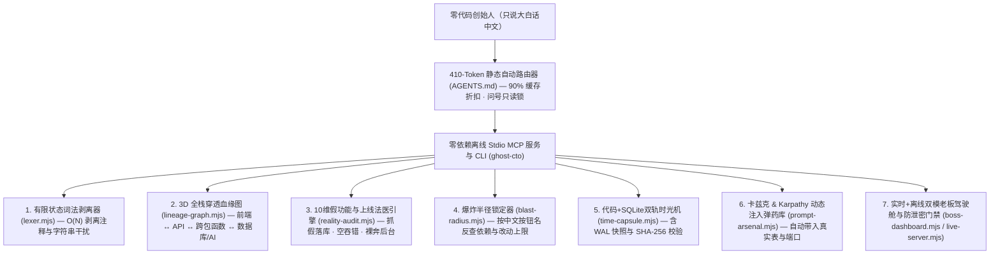

<div align="center">


# GhostCTO（影子 CTO）

### **「让每一个零基础小白，都能真正把 Vibe Coding 玩起来、做出来、不翻车。」**

**一行接入豆包/Trae、腾讯 WorkBuddy、CodeBuddy、Antigravity、Cursor、Claude Code：**  
**哪怕你一行英文代码都看不懂——从空白文件夹的第 1 句大白话开始，它自动替你拍板技术、0 Token 抓 AI 假按钮、锁死改动防连环崩、连代码带数据库一键吃后悔药。**

[-059669?style=flat-square)](#)
[-2563EB?style=flat-square)](#)
[-7C3AED?style=flat-square)](#)
[](./LICENSE)

[**📖 小白与 AI 对话全链路通关手册（照着抄，绝不翻车）**](./小白与AI对话全链路通关手册.md) ｜ [**English README**](./README.en.md) ｜ [**安装与国内软件配置指南**](./INSTALL.md) ｜ [**小白英文弹窗急救手册**](./docs/POPUP_DICTIONARY.md) ｜ [**安全说明**](./SECURITY.md)

</div>

<p align="center">
   卡兹克与Karpathy家底自动注入 -> 97分商用全绿" />
</p>

> [!TIP]
> 刚从 GitHub 下载解压？**你完全不需要背诵或复制任何复杂的提示词！**  
> 只要在项目里装上 GhostCTO，你只管在聊天框里说最普通的大白话（哪怕只有几个字：“我想做个美甲会员预约”），AI 就会自动变身保姆级技术合伙人，主动反问、自动铺真数据库、自动存快照、改崩了一句人话自动秒退回！  
> 👉 点击查看全保姆级真实对话演示：[**《零基础小白与 AI 对话全链路通关手册》**](./小白与AI对话全链路通关手册.md)

---

## 💡 一句话讲清楚：为什么你需要「影子 CTO」？

市面上的 AI 编程插件全是给**程序员**做的（满屏英文命令、Git 分支、单元测试术语）。  
而当你是一个**完全不懂代码的业务创始人 / 小白主理人**，用 AI 做商业项目时，你真正让人崩溃的**「八大懵逼瞬间」**从来没人管——直到 **GhostCTO** 出现：

| 纯小白做产品的「八大懵逼瞬间」 | 普通 AI 软件的表现 | **GhostCTO（影子 CTO）的硬核解法** |
| :--- | :--- | :--- |
| **1. 黑盒失明懵**<br>左边一排英文代码文件，根本不知道项目做到了哪、能不能用 | 只会往黑框里吐代码 | 自动生成离线网页 **《老板全景驾驶舱.html》**，双击打开全中文看清健康分、真假接口与一键复制修复按钮 |
| **2. 隔夜打不开懵**<br>昨天还好好的，重启电脑后网页打不开或报端口占用 `EADDRINUSE` | 让你自己去终端敲 `lsof`、`kill -9`、`npm build` | 自动生成 **《双击启动项目.command / .bat》**，双击自动清卡死端口、补打包、拉起服务并打开浏览器 |
| **3. 技术选择题懵**<br>AI 反问你：“用 Prisma 还是 Drizzle？JWT 还是 Session？” | 把架构锅甩给不懂技术的老板 | **CTO 代拍板铁律**：严禁向老板提任何技术选型问题，AI 自动按最稳方案拍板，只允许问纯业务规则 |
| **4. 随口问一句乱改懵**<br>只是问一句“现在视频怎么存的？”，AI 直接把 8 个文件改废了 | 听不懂咨询和动手的区别 | **问号只读锁**：识别咨询类语气强制锁死文件只读；内置《英文弹窗翻译卡》且全程沙箱静默 0 惊吓 |
| **5. 表面能点重启全丢懵**<br>按钮能点、提示成功，结果数据只存内存没进数据库，重启全没 | 极度喜欢写内存假数组与空 `catch {}` 糊弄交差 | **0-Token 3D 全栈真假穿透引擎**：毫秒级追踪 `前端按钮 -> API路由 -> 跨包函数 -> SQLite真表/真AI请求` |
| **6. 打地鼠连环崩懵**<br>让它改个后台列表颜色，结果前台登录挂了，越修越烂 | 每次乱改十几个无关文件 | **爆炸半径锁定器**（支持直接搜中文按钮名！）：改前锁死允许修改文件上限、API 契约与静态 `dist` 必跑打包 |
| **7. 换软件失忆懵**<br>国外软件额度用完换 **WorkBuddy** 或 **豆包/Trae**，新 AI 完全不认识项目 | 规则互不兼容，从头瞎猜烧光额度 | **8 大国内外软件同源双写 + `<350 token` 记忆胶囊**：换任何软件打开同一个文件夹，1 秒无缝接力 |
| **8. 不敢上线见客懵**<br>怕后台没设密码被人乱删、怕密钥泄露被盗刷、怕改坏丢客户数据 | 只管写 Demo，不管商用死活 | **代码 + SQLite（含 WAL）双轨原子时光机** + **10 维商用上线安检门**（自动抓裸奔管理端接口与明文密钥） |

---

## 🇨🇳 原生适配国内 + 海外 8 大主流 AI 软件（换软件不失忆）

只需初始化一次，`GhostCTO` 会在项目内同时生成 8 套原生配置与**零依赖本地离线 MCP 服务**（无需联网下载、不跳英文弹窗）：

| 软件名称 | 自动生成的原生适配文件 | 激活方式 |
| :--- | :--- | :--- |
| **腾讯 WorkBuddy** | `.workbuddy/skills/*` + `.workbuddy/rules/ghost-cto.md` + `.workbuddy/mcp.json` | 打开项目文件夹即自动生效 |
| **腾讯 CodeBuddy** | `.codebuddy/CODEBUDDY.md` + `.codebuddy/rules/ghost-cto.md` + `.codebuddy/skills/*` | 打开项目文件夹即自动生效 |
| **字节 豆包编程 / Trae** | `.trae/rules/project_rules.md` + `.trae/skills/*` + `.trae/mcp.json` | Trae 打开即生效；附赠 **豆包桌面版** MCP 一键导入 JSON |
| **Google Antigravity** | `.agents/plugins/ghost-cto/`（含 `plugin.json`, `hooks`, `skills`, `AGENTS.md`） | 原生 Workspace Plugin 自动挂载 |
| **Cursor** | `.cursor/rules/ghost-cto.mdc` (`alwaysApply: true`) + `.cursor/mcp.json` | 打开项目文件夹即自动生效 |
| **Claude Code** | `CLAUDE.md` (`@AGENTS.md`) + `.claude/skills/*` + `.mcp.json` | 启动自动挂载规则、技能与 MCP |
| **Windsurf** | `.windsurf/rules/ghost-cto.md` | 打开项目自动生效 |
| **OpenAI Codex / 通用** | `AGENTS.md` | 遵循开放 `AGENTS.md` 行业标准 |

---

## 💰 费不费 Token？不但不费，反而帮你省下 75%～85% 的冤枉 Token！

很多新手担心：“装这么深的系统会不会很烧钱？”——恰恰相反！没有 GhostCTO 时，AI 为了找一个报错要盲目读取十几个大文件（单次烧掉 `30,000+ tokens`），改崩返工三次直接烧掉 `150,000+ tokens`。

**GhostCTO 采用三层「零废话编译器级省流架构」：**
1. **重活全部交给本地 Node.js 引擎（消耗 `0 LLM Token`）**：词法去噪、跨包 AST 函数调用链追踪、前后端接口对账、SQLite 数据库快照全部在本地 CPU `< 80 毫秒` 算完，只把 `< 220 tokens` 的精准 `文件:行号` 坐标喂给大模型！
2. **常驻路由锁死 `410 tokens` 且 100% 字节级静态不变**：融合 Karpathy 极简第一性原理，完美命中各大模型底层的 **KV Prefix Cache（前缀缓存 90% 费用折扣）**，每轮对话实际计费仅折合 **`~41 tokens`**！
3. **7 大专业技能包 + 8 套大师提示词库按需懒加载（每个技能仅 `247～489 tokens`，提示词库平时 `0 Token`）**：融合 **数字生命卡兹克 (KKKKhazix)** 苏格拉底单问法、**Andrej Karpathy** 外科手术铁律与 **Linear/Stripe 去 AI 塑料味高定审美**，平时睡觉 `0 消耗`，用到哪句点哪个！

---

## ✨ 内置「数字生命卡兹克 & 全网封神」大师提示词引擎（动态注入真实家底！）

普通开源提示词仓库只给你一堆空白模板，AI 依然不知道你项目里有哪些真实数据表、跑在哪个端口、改完要不要重新打包。  
**GhostCTO 独创「0 常驻 Token · 家底动态注入弹药库」（`kernel/prompt-arsenal.mjs`）**：打开《老板全景驾驶舱.html》切换到 **`✨ 大师级神级提示词 (8)`** 标签页，输入一句你的想法点复制，自动把**你的想法 + 本项目真实 SQLite 表名 + 端口 + 前端打包护栏**打包好：

1. 🔥 **苏格拉底式「单问澄清」立项令**（源自卡兹克追问法：先管住手，每次只问 1 个生意选择题，最多 4 问收口）
2. 🌍 **Karpathy 极简外科手术防崩令**（源自 GitHub 21万星 `CLAUDE.md`：最少代码、绕远路主动劝阻、严禁动无关代码）
3. 🎨 **去 AI 塑料味 · Linear/Stripe 高定界面重塑令**（封杀廉价紫蓝渐变、Emoji 卡片汤与编造假数字）
4. 🧯 **三连败死循环 · 强制急刹车破局令**（同一个 Bug 改了 3 遍还没好时一键叫停，6 步全链路捉真凶）
5. 👑 **顶尖领域专家选角 · 商业与产品问诊令**（源自卡兹克专家选角法：先选最毒辣内行，砍掉伪需求）
6. 🚀 **防跑偏任务书 · 负面边界施工蓝图令**（灵感自 `khazix-skills/leader`：明确「第一版坚决不做清单」）
7. 🧹 **代码·记忆·驾驶舱「三层洁癖同步」令**（灵感自 `khazix-skills/neat-freak`：彻底消灭换软件失忆与脑腐）
8. ✍️ **去 AI 爹味与黑话 · 商业页面文案洗稿令**（灵感自卡兹克四检法：清剿“赋能/抓手/闭环”，全改说人话）

---

## 🏗️ 为什么它能拿 10,000+ Star？（七大硬核确定性内核，绝非水提示词）

<p align="center">
  
</p>



---

## 🚀 30 秒极速安装上手

> **零外部依赖**：仅需电脑装有基础 `Node.js >= 18`，无需配置 Python、无需联网拉取第三方包。

### 方式零：纯小白双击弹窗选文件夹（真·一行命令都不敲！）
从 GitHub 下载解压后：
- **苹果电脑 (macOS)**：直接双击仓库里的 **`双击安装到我的项目.command`**，在弹出的访达（Finder）窗口里点选你的项目文件夹，自动装好并自动打开《老板全景驾驶舱》！
- **Windows 电脑**：直接双击仓库里的 **`双击安装到我的项目.bat`**，在弹出的窗口里点选你的项目文件夹即可！

### 方式一：发一句话让 AI 替你装
直接把下面这句话复制发给你正在用的 **WorkBuddy / 豆包 / Trae / Antigravity / Cursor**：
> **“请帮我在当前项目运行 `npx ghost-cto init` 安装影子 CTO，做一次真假体检并生成《老板全景驾驶舱.html》。”**

### 方式二：一行终端命令接入任意项目
```bash
# 在你的项目文件夹运行（或传入项目路径）
npx ghost-cto init /path/to/your-project
```

执行完毕后，打开你的项目文件夹，你会立刻多出 **3 个全中文神器**（再加 **Git 自动防泄密门禁**）：
1. 🖥️ **`老板全景驾驶舱.html`（离线版）** —— 随时双击打开，健康总分、较初检提升分数、8 套大师提示词、真假接口与一键复制修复话术一目了然！
2. ⚡ **`打开实时驾驶舱.command` / `.bat`（0-Token 实时交互版）** —— 双击在浏览器开启本地引擎直连：**不消耗 1 个大模型 Token**，直接在网页上点按钮完成「80毫秒重新体检」、「一键双备份代码+数据库」、「一键秒退回历史好版本」、「搜中文按钮名秒查影响范围」！
3. 🚀 **`双击启动项目.command` / `.bat`** —— 以后重启电脑打不开网页，双击它自动清卡死端口、自动补打包、自动打开浏览器！
4. 🛑 **Git 提交防泄密急刹车钩子（`.git/hooks/pre-commit`）** —— 一旦不小心把 `.env` 或阿里云 `LTAI` / 腾讯云 `AKID` / 大模型 `sk-` / 数据库密码写进代码点提交，本地毫秒级自动拦截报警！

---

## 🌐 全栈多语言与国内主流框架原生支持（不挑项目）

无论你的项目是用什么技术栈生成的，GhostCTO 的零依赖本地编译器内核都能精准穿透（无需装任何插件）：
- **前端与小程序**：React (`.jsx`/`.tsx`)、Vue 3 单文件组件 (`.vue`)、Svelte (`.svelte`)、Next.js App/Pages Router（原生支持 `@/` 与 `~/ ` 路径别名防误报！）、原生 HTML、`String.raw` 模板，以及**微信小程序 `wx.request` / `uni-app` (`uni.request`) / `Taro.request`**！
- **后端框架**：Node.js 原生 `http`、Express / Fastify / Hono / Koa、Next.js API Routes、**Python FastAPI / Flask / Django**！
- **数据库与 ORM 识别**：原生 SQL / `node:sqlite`、**Supabase (`.from().insert/select`)**、**Prisma**、**Drizzle ORM (`pgTable`/`sqliteTable`)**、**Mongoose**、**Python SQLAlchemy / Django ORM**！

---

## 🛠️ 完整 CLI 与 MCP 工具箱参考

| 命令 / MCP 工具 | 作用（0 Token 本地确定性执行） |
| :--- | :--- |
| `ghost-cto try` | 在本机沙箱自动跑完 1 秒全链路真机演练（测试 8 平台安装、MCP 跨进程通信、抓假功能与数据库回退） |
| `ghost-cto bootstrap "零碎想法" [目录]` | **零基础从 0 到 1 神器**：哪怕只有几个字的模糊念头，自动拆清蓝图并一键铺好 **97 分零出错 SQLite 全栈可运行底座**（自带防白屏与报错秒修条） |
| `ghost-cto incubate "零碎想法" [目录]` / `ghost_incubate_idea` | **零碎想法孵化器**：把说不清的碎片想法自动变成清晰 4 大功能、真实数据表结构与防翻车清单（`.vibe/blueprint.md`） |
| `ghost-cto verify [目录]` / `ghost_verify_code` | **代码零出错编译门禁**：0-Token 检查全部 JS 语法、HTML `<script>` 脚本语法、JSON 格式与前后端真假接口，有错不准 AI 交差 |
| `ghost-cto init [目录]` | 一键同步 8 大国内外软件规则/Skills/MCP（增量合并绝不覆盖原有工具）+ 创建初始存档 + 生成驾驶舱 |
| `ghost-cto studio [目录]` | 启动 **0-Token 实时交互版老板驾驶舱**（支持浏览器直接点重新体检、双轨备份、秒回退与中文按钮影响反查） |
| `ghost-cto doctor [目录]` | 22 项真机体检：核验各软件配置文件、Token 预算，并从外部目录拉起真实子进程测试双协议 MCP 通信 |
| `ghost-cto prompts [目录]` / `ghost_master_prompt` | 按需导出自动注入本项目真实数据表、端口与打包护栏的 8 套大师级提示词（卡兹克 & Karpathy 精选） |
| `ghost-cto audit [目录]` / `ghost_reality_audit` | 10 维真假功能与商用上线安检（抓样板房空壳、假保存、裸奔 `/api/admin`、空吞错、泄漏密钥） |
| `ghost-cto xray [目录]` / `ghost_xray_lineage` | 绘制 `前端 -> API -> 跨包函数 -> SQLite 表 / 真实外部大模型` 全栈穿透表（支持 JS/TS/JSX/HTML/Python） |
| `ghost-cto impact "按钮中文名"` / `ghost_blast_radius` | 改代码前按中文界面词或模块名锁定最小修改文件集与必跑打包命令 |
| `ghost-cto save "说明"` / `ghost_save_checkpoint` | 原子备份 Git 代码与全部 `.sqlite`/`.db`（含 `-wal` 日志与 SHA-256 校验） |
| `ghost-cto rewind [编号]` / `ghost_rewind_checkpoint` | 自动先存一份急救备份，再把代码和数据库一起原子回退到指定存档点 |
| `ghost-cto learn --rule "..."` | 把踩过的坑写入 `.vibe/immune-rules.json`，生成自定义静态扫描规则永久免疫 |
| `ghost-cto budget` | 审计常驻提示词与各技能包的精确 BPE Token 占用 |

---

## 📜 开源协议

本项目基于 [MIT License](./LICENSE) 完全免费开源。献给每一位不懂代码、却依然勇敢用 AI 把脑海中的商业产品变成现实的创造者。
